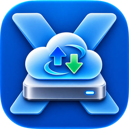

# AnyMount X

AnyMount X puts your cloud storage and servers in Finder: Google Drive, OneDrive, Dropbox, Box, S3-compatible storage, SFTP, SMB and WebDAV. Files appear right away and download on demand when you open them. It runs on macOS 14 or later, on Apple silicon and Intel Macs. Try it free for 14 days, then buy a one-time license from [1dot.ai](https://1dot.ai).

## Download

**[Download AnyMount X for Mac (DMG)](https://github.com/1dotaidev/AnyMountX-Releases/releases/latest/download/AnyMountX.dmg)**

Older versions and release notes: [Releases](https://github.com/1dotaidev/AnyMountX-Releases/releases).

## Install

1. Open the downloaded `AnyMountX.dmg`.
2. Drag AnyMount X to the Applications folder.
3. Open AnyMount X from Applications.

## Updates

The app updates itself from this repository's releases. It reads this feed:

`https://github.com/1dotaidev/AnyMountX-Releases/releases/latest/download/latest.json`

This repository hosts release binaries only; the source lives in a private repository.
